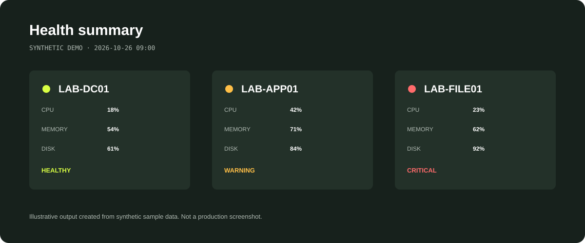
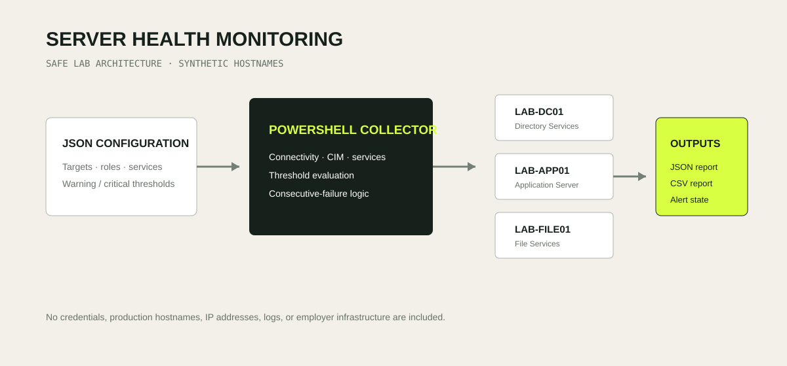
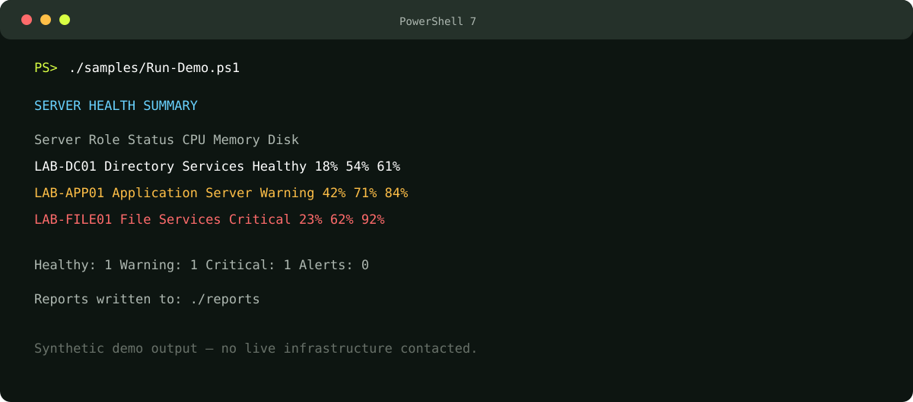

# PowerShell Server Health Monitoring

A portfolio-ready PowerShell project that checks Windows server availability, CPU, memory, disk utilization, uptime, and critical services. It produces JSON and CSV reports, tracks consecutive failures, and separates warning conditions from actionable critical alerts.

> This repository uses synthetic lab names and sample data. It contains no employer scripts, infrastructure details, credentials, logs, or proprietary material.



## Purpose and business problem

Small IT teams often discover resource exhaustion or stopped services only after users report an outage. Repeating the same manual checks also consumes time and produces inconsistent evidence.

This project demonstrates a safer, repeatable workflow that:

- Checks a defined server inventory on demand or on a schedule.
- Applies configurable warning and critical thresholds.
- Verifies required Windows services.
- Tracks consecutive failures to reduce noise from one-time interruptions.
- Exports structured evidence for troubleshooting, reporting, or later integration.

## Business value

| Operational need | Project response |
| --- | --- |
| Earlier visibility | Highlights capacity and service issues before they become user-reported incidents. |
| Consistent checks | Uses the same thresholds and collection process on every run. |
| Faster triage | Captures key health indicators in JSON and CSV formats. |
| Reduced alert fatigue | Escalates only after a configurable number of consecutive critical results. |
| Safer knowledge transfer | Documents configuration, setup, limitations, and security boundaries. |

These are intended operational benefits of the design, not production performance claims.

## Architecture and workflow



1. A JSON configuration defines synthetic or approved server targets, critical services, and thresholds.
2. PowerShell checks connectivity and collects health information through Windows remote management.
3. The evaluation layer classifies every server as `Healthy`, `Warning`, or `Critical`.
4. JSON and CSV reports preserve a timestamped result for review.
5. A local state file tracks consecutive critical results before raising an alert condition.

## Technologies used

- PowerShell 7
- Windows Remote Management and `Invoke-Command`
- CIM / WMI health data
- JSON configuration and state
- CSV and JSON report exports
- Pester 5 test structure
- Git and GitHub documentation workflow

## Repository structure

```text
server-health-monitoring/
├── config/
│   └── servers.example.json
├── docs/
│   ├── architecture.svg
│   ├── sample-console.svg
│   └── sample-summary.svg
├── samples/
│   └── Run-Demo.ps1
├── src/
│   └── Invoke-ServerHealthCheck.ps1
├── tests/
│   └── Invoke-ServerHealthCheck.Tests.ps1
├── CONTRIBUTING.md
├── LICENSE
├── README.md
└── SECURITY.md
```

## Quick start: safe demo mode

Demo mode does not contact any servers. It uses synthetic results for `LAB-DC01`, `LAB-APP01`, and `LAB-FILE01`.

```powershell
pwsh -File ./samples/Run-Demo.ps1
```

Generated reports are written to the ignored `reports/` directory.



## Lab setup

1. Install PowerShell 7.
2. Clone the repository.
3. Copy the example configuration to the ignored local configuration:

   ```powershell
   Copy-Item ./config/servers.example.json ./config/servers.json
   ```

4. Replace the synthetic names only with systems you are authorized to administer.
5. Confirm WinRM, firewall policy, DNS resolution, and least-privilege access follow your environment's standards.
6. Run the live check:

   ```powershell
   pwsh -File ./src/Invoke-ServerHealthCheck.ps1 -ConfigPath ./config/servers.json
   ```

## Configuration overview

```json
{
  "thresholds": {
    "cpuWarningPercent": 85,
    "memoryWarningPercent": 85,
    "diskWarningPercent": 80,
    "diskCriticalPercent": 90,
    "consecutiveFailuresBeforeAlert": 2
  }
}
```

Thresholds are deliberately explicit so operators can review and adjust them without modifying the monitoring logic.

## Scheduling example

After validating the project in a lab, Windows Task Scheduler can run it under a dedicated, least-privilege service identity. Store the task definition and credentials according to organizational policy; do not place credentials in this repository.

```powershell
pwsh.exe -NoProfile -File "C:\Monitoring\src\Invoke-ServerHealthCheck.ps1" `
  -ConfigPath "C:\Monitoring\config\servers.json"
```

## Testing

The demo path is deterministic and does not require infrastructure access.

```powershell
Invoke-Pester ./tests
```

The tests verify that every synthetic server is evaluated and that both report formats are created.

## Results and limitations

The sample run demonstrates healthy, warning, and critical classifications, structured report creation, stopped-service detection, and failure-state tracking. Production alert delivery is intentionally left as an integration boundary so credentials and webhook endpoints are never embedded in the sample.

Current limitations:

- Windows-oriented collection through WinRM.
- No built-in credential storage.
- No external notification connector enabled by default.
- CPU is a point-in-time reading rather than a long-duration performance baseline.

## Lessons learned

- Monitoring is useful only when thresholds are actionable and documented.
- A single failed check should not automatically become a high-priority incident.
- Structured output makes troubleshooting, reporting, and future integrations easier.
- Operational scripts need clear failure handling, safe configuration, and privacy boundaries—not only successful-path code.

## Security and privacy considerations

Read [SECURITY.md](SECURITY.md) before adapting the project. The repository intentionally excludes live reports, local state, production inventories, credentials, and internal infrastructure evidence through `.gitignore` and documented safe-use practices.

## Future improvements

- Optional Microsoft Teams or email notification adapters using environment-based secrets.
- HTML dashboard generation from the latest JSON report.
- Performance history and trend reporting.
- Linux collection through a separate, least-privilege SSH module.
- Signed scripts and deployment guidance for controlled environments.

## Author

**Joshua Thompson**  
[LinkedIn](https://www.linkedin.com/in/joshuat3/) · [Portfolio](https://joshua-it-portfolio.vercel.app)

